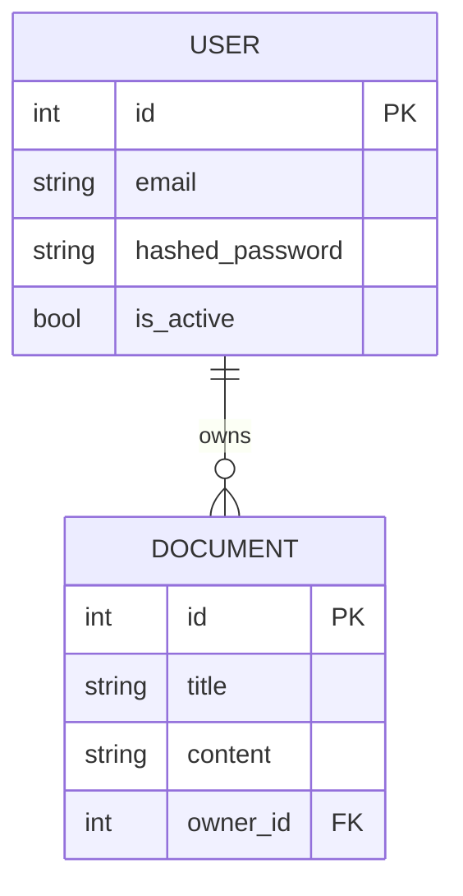

# Database Design & Relationships

We are using a **Relational Database** (PostgreSQL). The core concept is linking tables together using **Keys**.

## The SchemaC:\Users\sijan\.

### 1. Users Table (`users`)
This table stores all registered users.
-   **`id`** (Integer, Primary Key): Unique ID for each user (e.g., 1, 2, 3).
-   **`email`** (String): The user's email. Must be unique.
-   **`hashed_password`** (String): We never store plain passwords. We store a "hash".
-   **`is_active`** (Boolean): To enable/disable accounts without deleting them.

### 2. Documents Table (`documents`)
This table stores the files/text uploaded by users.
-   **`id`** (Integer, Primary Key): Unique ID for each document.
-   **`title`** (String): Document title.
-   **`content`** (String): The actual text content.
-   **`owner_id`** (Integer, Foreign Key): **This is the link!** It stores the `id` of the User who owns this document.

## The Relationship: One-to-Many
**One User** can have **Many Documents**.
**One Document** belongs to **One User**.

### Visual Diagram


### How it works in Code (`models.py`)

1.  **The Foreign Key**:
    ```python
    owner_id = Column(Integer, ForeignKey("users.id"))
    ```
    This tells the database: "The value in this column MUST exist in the `users` table's `id` column."

2.  **The Relationship (SQLAlchemy Magic)**:
    ```python
    # In User model
    documents = relationship("Document", back_populates="owner")

    # In Document model
    owner = relationship("User", back_populates="documents")
    ```
    These lines don't create columns in the database. They allow you to do this in Python:
    -   `my_user.documents` -> Returns a **list** of all documents owned by `my_user`.
    -   `my_doc.owner` -> Returns the **User object** who owns `my_doc`.
